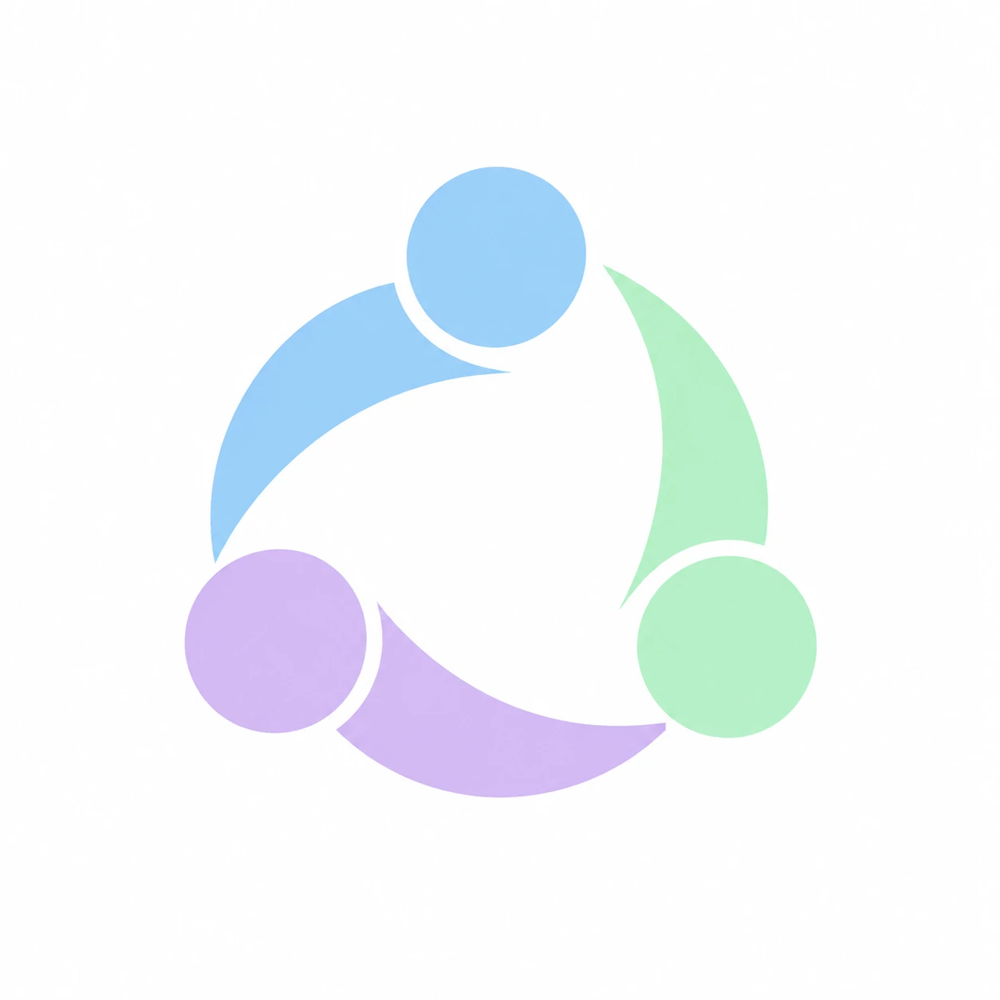

<p align="center"></p>

<h1 align="center">Bridge</h1>

<p align="center">Give your coding agents one shared context: continue sessions, exchange progress, and share memory and rules between Claude Code and Codex.</p>

<p align="center"><a href="README.md">简体中文</a> · <strong>English</strong></p>

---

When you use several coding agents, each one is an island. Thirty turns of debugging in Claude Code mean nothing to Codex. A coding preference you corrected in one agent is unknown to the other. `CLAUDE.md` and `AGENTS.md` drift apart. Two agents working at once have no idea what the other just changed.

Bridge is a local tool that solves this with one unified model. Your data stays on your machine by default.

## Why Bridge

Existing projects mostly solve one piece of this. Bridge puts **sessions, memory, files, and live collaboration** on a single unified event model.

| Project | Native session migration | Live collaboration | Shared memory | Rules / skill sync | Adding an agent |
| --- | :---: | :---: | :---: | :---: | --- |
| **Bridge** | ✅ | ✅ | ✅ | ✅ | One adapter, any language |
| continues | Handoff document | — | — | — | Covers many agents |
| cc-sync | ✅ two agents only | — | — | — | Pairwise conversion |
| rses | Context injection | — | — | — | Three built in |
| [agentmemory](https://github.com/rohitg00/agentmemory) | — | — | ✅ | — | MCP + hooks |
| [Memorix](https://github.com/AVIDS2/memorix) | — | — | ✅ | ✅ | No native session migration |
| agentsync | — | — | — | ✅ symlinks | Files only |

> Based on each project's public description. They may have changed since; corrections are welcome.

### 1. Native migration, not a summary
A session is converted to the target agent's own format and appears in its `resume` list, with real conversation history and tool calls. Tools with no equivalent are explicitly downgraded to text, and each migration reports what was omitted, compressed, or truncated. Lossy is never presented as lossless.

### 2. Keep both sides up to date after migrating
Migration isn't one-shot. Bridge records a sync boundary for both sides, so new work on either side can be appended to the other under the same session ID. When both sides have changed, you choose which one wins.

### 3. Live progress sharing
On every prompt, a hook injects what other agents have done: files changed, the latest instruction, and their latest reply. Read watermarks keep it incremental, and a token budget caps it. Verified in both directions on real Claude Code and Codex clients.

### 4. Hub architecture: no pairwise adapters
Every agent is converted to unified events through an adapter, so N agents need N adapters. External adapters speak JSON-RPC over stdio in any language, and a conformance suite is included.

### 5. Compatibility as a first-class problem
Agent session files aren't public interfaces, and upgrades can change them. So:

- Unverified versions are read-only by default, and migration falls back to a handoff document instead of silently corrupting data.
- New versions are checked automatically: the **real client** must load a probe session before writing is enabled. This runs in a temporary directory, with no network and no credentials.
- You can also enable the current version by hand in the app, and revoke it at any time.

### 6. Safe writes
Backups before writing, temp file plus atomic rename, read-back verification, and rollback on failure. Multi-resource writes keep an operation journal, so a process killed at any step can recover. Uninstalling keeps anything you edited by hand afterwards.

### 7. Private by default
- Redaction runs before anything reaches the database, with built-in rules for common secrets. Reasoning is never stored.
- Path exclusion is a safety floor: project config can't remove a global exclusion, and symlinks can't get around it.
- No TCP ports, only a Unix socket with mode 0600.
- Automatic memory extraction is off by default, because it sends conversation excerpts to a model service. You are told exactly that before enabling it.

## Features

| Area | Capabilities |
| --- | --- |
| Session migration | Index and filter sessions, native migration, tool mapping, trimming long sessions, handoff-document fallback, two-way updates after migrating |
| Live collaboration | Incremental collection, hook-injected progress, MCP queries (`session_list`, `session_events`, `memory_search`), file claim warnings |
| Memory | Global preferences and project memory, optional automatic extraction, supersession, review, forget without re-extraction |
| File sync | One source for rules and skills, symlinks or generated copies, drift detection, adopt or overwrite |
| Configuration | Four merged layers, per-category and per-agent switches, sync direction, `why` explains where a value came from |
| Desktop app | Native macOS window and menu bar: status, migration, pause syncing, memory and settings |

## Quick start

### Download (recommended)

Requires macOS 13+ on Apple Silicon or Intel.

1. Download `Bridge-<version>.dmg` from [Releases](https://github.com/fufuandfoufou/bridge/releases/latest) and drag Bridge to Applications.
2. This build is **not signed or notarized by Apple**, so macOS blocks it until you allow it once in Terminal:

   ```bash
   xattr -cr /Applications/Bridge.app
   ```

3. Open Bridge and click "接入 agent" (connect). Don't move the app afterwards.
4. Codex runs hooks only after you trust them, so review them once under `/hooks` in Codex.

### Build from source

Requires Go 1.27+. Building the desktop app also needs Xcode.

```bash
git clone https://github.com/fufuandfoufou/bridge.git && cd bridge
go build -o bin/bridge ./cmd/bridge

./bin/bridge init          # detect agents, install hooks and MCP, register the service
./bin/bridge status        # see which channels are actually in effect
./bin/bridge sessions      # list sessions
./bin/bridge handoff <session-id> --to codex
```

Build the desktop app:

```bash
./scripts/build-app.sh     # creates dist/Bridge-<version>.dmg
```

## Common commands

| Command | Purpose |
| --- | --- |
| `init` / `uninstall` | Connect / remove and restore |
| `status` / `doctor` | Connection state / self-check |
| `sessions` / `handoff` | List / migrate sessions |
| `plan` / `sync` | Preview / apply rule and skill sync |
| `why <path-or-memory-id>` | Explain a sync result and the config behind it |
| `memory list/review/add/edit/forget/extract` | Manage memory |
| `adapter list/trust/test` | External adapters and conformance tests |

Any command accepts `--set key=value`. Configuration has four layers: built-in defaults → `~/.config/bridge/config.toml` → `<repo>/.bridge.toml` → `--set`.

## Compatibility

| Agent | Writable out of the box | Other versions |
| --- | --- | --- |
| Claude Code | 2.1.x | Automatic check or manual enable |
| Codex | 0.144.x, 0.166.x | Automatic check or manual enable |

Verified on real clients: native migration and resume between Claude Code 2.1.317 and Codex CLI 0.144.1, resume on Codex 0.166.0-alpha.6, and hook injection in both directions.

## Status and limitations

This is an early project. Please try it on sessions you don't depend on first.

- Migration isn't a byte-for-byte copy: reasoning isn't carried over, unmappable tools become text, and very long sessions are compressed.
- Appended history takes effect when a session is reopened; a running client won't notice it. Codex has no registry of running threads, so "in use" is inferred from recent file changes.
- Codex's native paginated sessions can't be appended to yet, only copied into a new session.
- File claims can warn or block, but only cover the edit tools of connected agents: shell commands and manual edits aren't protected, and nothing is blocked while the daemon is offline.
- Task board, worktree mode, MCP config sync, and history import aren't implemented.
- macOS only for now.

## Docs and contributing

- [External adapter protocol](docs/adapter-protocol.md)
- [Adapter example](examples/bridge-adapter-demo)

Run the tests:

```bash
go test ./...
```

Acceptance tests live in `test/acceptance` and run entirely under an isolated HOME, never touching real agent data.

Adapters for new agents are welcome. Start by passing `bridge adapter test <id>`.

## License

Licensed under the [Apache License 2.0](LICENSE).
